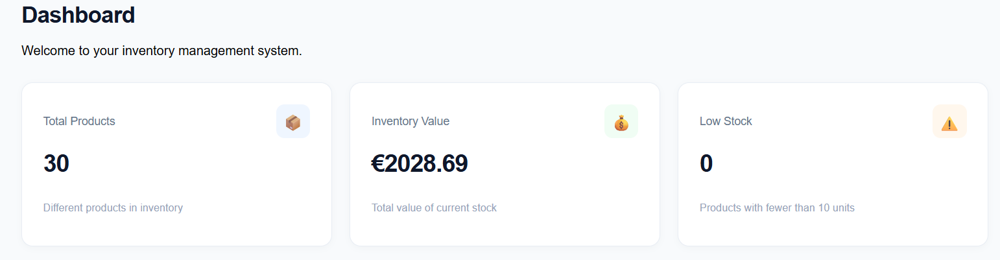
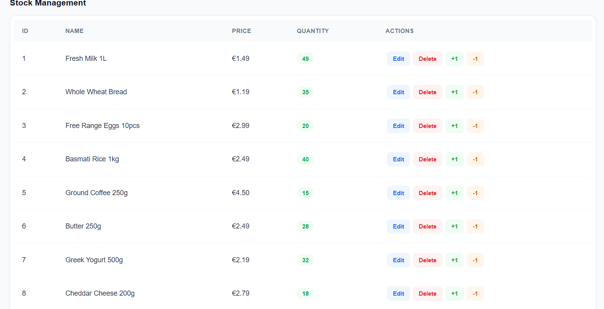
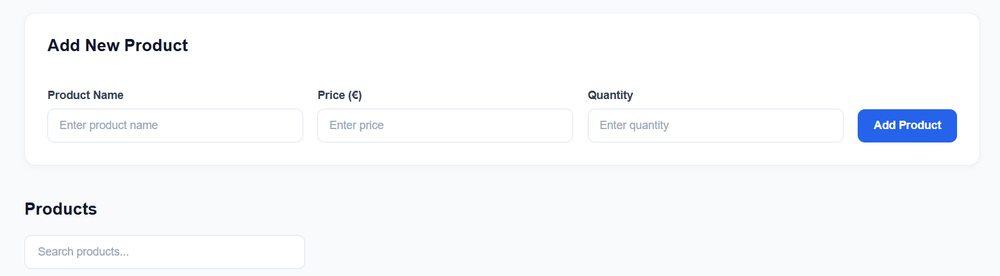

# GoStock — Inventory Management System

GoStock is a full-stack inventory management application built with **Go** and **Vue.js**. It allows users to manage products, monitor stock levels, and perform inventory operations through a web-based dashboard.

## Live Demo

- **Frontend:** https://gostock-frontend.onrender.com/
- **Backend API:** https://gostock-3t85.onrender.com/api/products

## Features

- View all products in an inventory dashboard
- Add new products
- Edit existing product details
- Delete products
- Update product stock quantities
- Search and manage inventory
- Low-stock alerts
- REST API for frontend-backend communication
- JSON-based data storage

## Screenshots

### Dashboard


### Inventory Management


### Product Management


## Technologies Used

**Backend**
- Go
- REST API
- HTTP
- JSON

**Frontend**
- Vue.js 3
- JavaScript
- HTML
- CSS
- Vite

**Tools & Deployment**
- Git and GitHub
- Render

## Project Structure

```text
GoStock/
├── api.go
├── main.go
├── product.go
├── inventory.go
├── persistence.go
├── input.go
├── inventory_test.go
├── go.mod
└── frontend/
    ├── src/
    ├── public/
    ├── package.json
    └── ...
```

## Running Locally

### Backend

1. Make sure Go is installed.
2. Clone the repository:

```bash
git clone https://github.com/yiouri4/GoStock.git
cd GoStock
```

3. Start the backend:

```bash
go run .
```

The API runs locally on port `8080` by default.

### Frontend

1. Open another terminal.
2. Navigate to the frontend directory:

```bash
cd frontend
```

3. Install dependencies:

```bash
npm install
```

4. Start the development server:

```bash
npm run dev
```

The frontend will be available at the local address displayed by Vite.

## Running Tests

Run the Go tests with:

```bash
go test ./...
```

## Future Improvements

- Database integration for persistent storage
- User authentication and authorization
- Improved inventory analytics and reporting

---

Developed as a personal portfolio project to practice Go backend development, REST APIs, and full-stack application development.